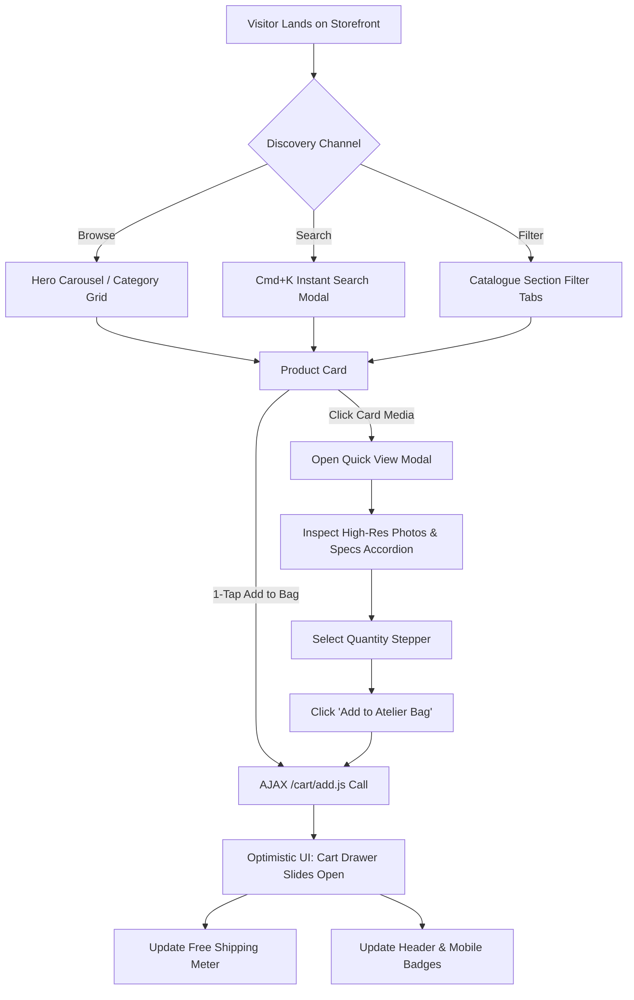
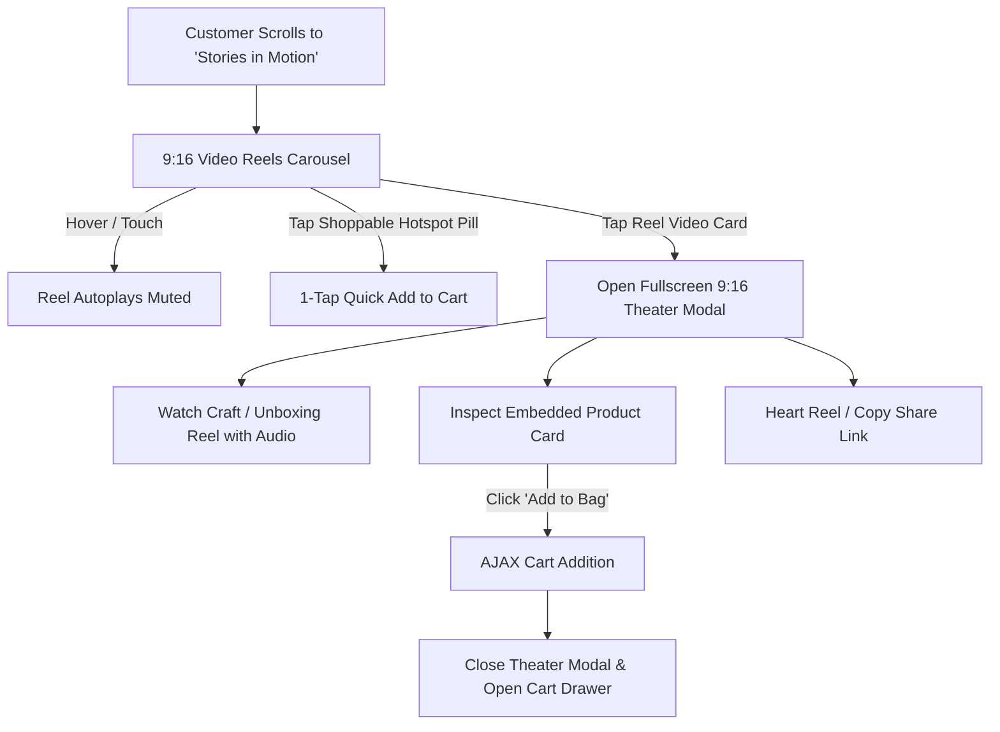
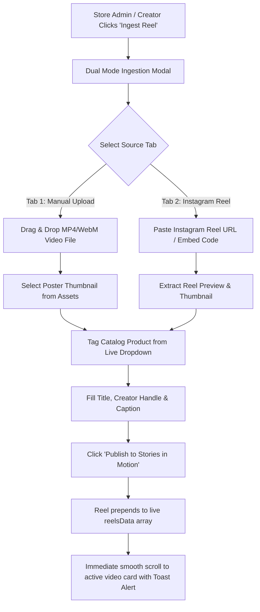

# GRAFFEINE TALES — UI/UX DESIGN SPECIFICATION & HI-FI ARCHITECTURE
**Version:** 2.0.0 (Shopify Online Store 2.0 Ready)  
**Brand Identity:** "Where Stories Become Art" — Artisanal Stationery, Handcrafted Journals & Bespoke Gifting  
**Design Philosophy:** Editorial Luxury, Tactile Warmth, Craft Storytelling, Interactive Video Commerce

---

## 1. DESIGN SYSTEM & DESIGN TOKENS

### 1.1 Color Palette & Semantics

| Token | Hex Value | Role & Usage Context |
| :--- | :--- | :--- |
| `--c-primary` | `#5A3825` | **Warm Saddle / Atelier Leather.** Primary buttons, key display headings, active indicators. |
| `--c-accent-clay` | `#C85A32` | **Terracotta Clay.** High-impact CTA highlights, sale tags, price accents, focus rings. |
| `--c-espresso` | `#363638` | **Charcoal Espresso.** Deep editorial dark mode, story narrative background, high-contrast text. |
| `--c-bg-cream` | `#FDFBF7` | **Atelier Cream.** Global primary background; creates warm, tactile paper-like canvas. |
| `--c-bg-sand` | `#F8F5F0` | **Subtle Sand / Warm Bone.** Card surfaces, modal backdrops, dropdown mega-menus. |
| `--c-gold` | `#D4AF37` | **Wax Seal Gold.** Star ratings (5.0 ★★★★★), verified badges, member tier privilege. |
| `--c-sage` | `#2D6A4F` | **Botanical Sage.** "Studio Drop" new launch tags, eco-sustainable packaging pills. |
| `--c-border-subtle`| `rgba(90, 56, 37, 0.12)` | Hairline dividers, card outlines, input borders. |
| `--c-glass-bg` | `rgba(253, 251, 247, 0.85)` | Glassmorphism navigation, bottom docks, frosted drawer headers. |

### 1.2 Typography Hierarchy

```
Primary Display Serif:  'DM Serif Display', Georgia, serif (Headings & Hero statements)
Secondary Serif:        'Playfair Display', serif (Quotes, story paragraphs, editorial subheads)
Clean UI Sans:          'Inter', -apple-system, sans-serif (Body copy, buttons, labels, prices)
Tactile Script Accent:  'Patrick Hand', cursive (Handwritten notes, artisanal tags, sticky accents)
Subheadings:            'Quicksand', sans-serif (Category pills, metadata badges)
```

| Scale Role | Font Family | Size (Desktop) | Size (Mobile) | Weight | Line Height |
| :--- | :--- | :--- | :--- | :--- | :--- |
| **Hero Display** | DM Serif Display | 52px – 64px | 34px – 40px | Regular (400) | 1.08 |
| **Section Title** | DM Serif Display | 38px – 44px | 28px – 32px | Regular (400) | 1.15 |
| **Card / Modal H3** | DM Serif Display | 22px – 26px | 18px – 20px | Regular (400) | 1.25 |
| **Section Tag / Pill** | Quicksand | 12px – 13px | 11px | SemiBold (600) | 1.0 (Uppercase, 0.12em track) |
| **Body Primary** | Inter | 16px | 15px | Regular (400) | 1.65 |
| **Pricing Primary** | DM Serif Display | 24px – 28px | 20px – 22px | Bold (700) | 1.0 |
| **Caption / Specs** | Inter | 13px – 14px | 12px – 13px | Medium (500) | 1.5 |

### 1.3 Spatial System & Elevation

- **Base Spacing Unit:** 4px (4, 8, 12, 16, 24, 32, 48, 64, 96, 128px)
- **Container Max-Width:** 1340px (with 24px side gutters on desktop, 16px on mobile)
- **Border Radii:**
  - Standard Cards: `16px`
  - Modals & Drawers: `24px` (Top corners on mobile sheet: `24px 24px 0 0`)
  - Buttons & Pills: `999px` (Full pill radius for tactile, smooth touch)
  - Thumbnails: `10px`
- **Shadow Elevations:**
  - `Elevation-1 (Cards):` `0 6px 20px rgba(90, 56, 37, 0.06)`
  - `Elevation-2 (Hover):` `0 14px 34px rgba(90, 56, 37, 0.12)`
  - `Elevation-3 (Drawers & Modals):` `-10px 0 40px rgba(54, 54, 56, 0.18)`
  - `Elevation-Glass:` `backdrop-filter: blur(16px); -webkit-backdrop-filter: blur(16px)`

---

## 2. RESPONSIVE BREAKPOINT SYSTEM

| Breakpoint | Target Devices | Layout Behavior |
| :--- | :--- | :--- |
| **Mobile (`< 768px`)** | iPhone 13/14/15/16, Pixel, Galaxy | Single-column stack, bottom glassmorphism nav bar, full-width touch drawers, horizontal swipeable product carousels. |
| **Tablet (`768px – 1024px`)** | iPad Mini, iPad 10th, Air | 2-column asymmetric cards, collapsed mega-menu, touch-optimized swipers. |
| **Desktop (`> 1024px`)** | MacBook, Laptops, 4K Displays | Multi-column asymmetric editorial grid, floating sticky header with full mega-menu, hover micro-animations, slide-over side drawers. |

---

## 3. COMPONENT & SECTION SPECIFICATIONS

### 3.1 Sticky Header & Mega-Menu Navigation
- **Steam Animated Logo:** Coffee cup brand mark with dual CSS keyframe steam wisps (`w1`, `w2`) floating upward in loop.
- **Mega-Menu Grid:** Hover-activated multi-column dropdown featuring category links (Stationaries, Journals, Handcrafted Décor, Events, Bulk Gifting) with curated visual drop thumbnails.
- **Header Actions:** Instant Search Trigger (Cmd+K), Wishlist Counter with live badge, Slide-Over Bag trigger with dynamic count indicator.
- **Mobile Hamburger:** Smooth SVG transformation into close icon; opens clean mobile drawer menu.

### 3.2 Hero Showcase (Banner Carousel)
- **Edge-to-Edge Visual Stage:** Curated editorial studio photographs with responsive aspect ratio.
- **Slide Progression:** Subtle pagination indicators, touch swipe support, and auto-pause on user interaction.
- **Typography:** Warm high-contrast overlay text with pill CTAs: *"Explore Studio Archive"* and *"Our Story"*.

### 3.3 Asymmetric Shop by Category Grid
- **Editorial Asymmetry:** 5 curated cards with varied aspect ratios (1 tall anchor card, 4 companion grid cards):
  1. *Stationaries & Desk Calendars*
  2. *Journals & Artisan Planners*
  3. *Handcrafted Décor & Teak Acrylic Coasters*
  4. *Personalized Events & Door Plaques*
  5. *Bulk Orders & Corporate Curations*
- **Visual Micro-interaction:** Hover scale (`1.03`), subtle dark scrim fade, and floating arrow button transition.

### 3.4 Product Cards & Atelier Catalogue
- **Badges:** Absolute positioned top-left pills:
  - Gold Foil: *"Bestseller"*
  - Sage Leaf: *"Studio Drop"* / *"New Launch"*
  - Terracotta: *"Save ₹XXX"*
- **Hover Action Overlay:** Quick View eye button + Wishlist heart toggle appearing smoothly on mouseover (always accessible via tap on mobile).
- **1-Tap Add to Bag:** Pill button with shopping bag icon triggering instant AJAX add-to-cart without full page reload.

### 3.5 Jawa Yezdi Inspired Story Section (Progressive Text Highlight)
- **Theme:** Deep Charcoal Espresso background (`#363638`) with Cream type (`#E9DFC2`).
- **Scroll-Triggered Illumination:** Text opacity transitions from muted 30% to luminous 100% as customer scrolls through the founder's atelier chronicle.
- **Interactive Trigger:** Modal button opening the founder's photo gallery and three craft pillars (Design-Led, Handmade & Tactile, Soulful Stories).

### 3.6 "Stories in Motion" — Shoppable Reels & Video Commerce
- **9:16 Vertical Video Track:** Horizontal drag-scroll carousel of craft process reels, unboxing videos, and aesthetic stationery flips.
- **Card Overlays:**
  - Live sound toggle (Mute / Unmute)
  - Shoppable product hotspot pill pinned to the bottom of each reel
  - 1-tap quick buy from inside video
- **Fullscreen Theater Modal:**
  - 9:16 centered video player with scrubber bar
  - Like heart animation with persistent counter
  - Interactive product drawer pinned directly inside theater stage
  - Arrow key navigation (← / →) and Escape listener
- **Dual Ingest Engine Modal:**
  - Creator interface supporting both direct MP4/WebM drag-drop upload and Instagram Reel URL ingestion.

### 3.7 Slide-Over Cart Drawer (Shopify Integrated)
- **Free Shipping Progress Meter:** Dynamic progress bar showing progress toward the ₹1,499 threshold:
  - Incomplete: *"Add ₹XXX more for FREE Studio Courier Shipping"*
  - Complete: *"✨ You unlocked FREE Studio Courier Shipping!"*
- **Quantity Steppers:** Live `+` / `−` adjustments calling `/cart/change.js`.
- **Checkout CTA:** Direct redirect to Shopify's secure, PCI-compliant `/checkout` page with Razorpay, UPI, cards, and COD support.

### 3.8 Dedicated Mobile Navigation & Bottom Bar
- **Glassmorphism Bottom Dock:** 5 quick navigation buttons:
  1. *Home* (Smooth scroll to top)
  2. *Categories* (Opens categorized drawer)
  3. *Wishlist* (Slide-over drawer with count badge)
  4. *Cart* (Slide-over drawer with live item badge)
  5. *Account* (Indian store concierge & tracking modal)

### 3.9 Journals & Diaries Luxury PDP (Inspired by Premium Stationery & Alicia Souza Planners)
- **Primary Canvas**: Warm Paper (`#F8F5ED`), Deep Coffee (`#4D351D`), Espresso Charcoal (`#363638`), and Logo Cream (`#E9DFC2`).
- **Visual Sticky Gallery**: Multi-angle viewer (Front Cover, 180° Lay-Flat, Inner Spreads, Sticker Sheets, Kraft Gift Packaging with Wax Seal) with lightbox zoom.
- **Buying Box**: Dynamic variant pills (Midnight Espresso Bookcloth, Terracotta Bloom, Sage Atelier, Celestial Indigo), layout selector (Dated 2027 vs. Undated), and 1-tap instant buy.
- **What’s Inside (The Anatomy of the Chronicle)**: 6 structured cards detailing Yearly Blueprint, 12 Monthly Panoramic Overviews, 52 Weekly Dashboards, Habit Grids, 40 Dot-Grid pages, and Linen Gusset Pocket.
- **Specifications Card Matrix**: 100 GSM FSC-certified bleed-resistant bamboo-cotton paper, true Smyth sewn 180° lay-flat binding, dual silk ribbons, A5 224-page format.
- **Gilded Sticker Book Feature**: Dedicated highlight for the 4 included sheets (180+ functional, coffee ritual, and gilded tab stickers).
- **Interactive Inner Page Flip**: Smooth scrollable spread inspector with full-resolution modal preview.
- **Pincode Delivery Estimator**: Live Indian PIN code delivery estimation (2–3 days Bluedart Air for metros, 3–5 days standard).
- **Video Commerce Reels**: 4 shoppable vertical video reels (ASMR unboxing, fountain pen bleed test, sticker setup, 180° flat desk flip).
- **FAQ Accordion & Verified Reviews**: Accessible answers to nib bleeding, paper weights, transit guarantees, and 4.98/5 verified buyer reviews.
- **Sticky Mobile Buy Bar**: Fixed bottom bar on mobile with title, price, and instant "Add to Bag" action.

---

## 4. HI-FI USER FLOWS (MERMAID ARCHITECTURE)

### 4.1 Flow 1: Product Discovery, Quick View & Instant Add-to-Bag



---

### 4.2 Flow 2: Video Commerce — "Stories in Motion" to Purchase



---

### 4.3 Flow 3: Slide-Over Cart to Shopify Native Checkout

```mermaid
flowchart TD
    A[Customer Opens Cart Drawer] --> B{Cart Total vs ₹1,499 Threshold}
    B -->|< ₹1,499| C[Display: 'Add ₹X more for FREE Shipping' + Progress Bar %]
    B -->|>= ₹1,499| D[Display: '✨ Unlocked FREE Studio Courier Shipping!' 100%]
    
    C --> E[Customer Adjusts Qty or Adds Recommended Edition]
    D --> F[Click 'Checkout Securely']
    E --> F
    
    F --> G[POST /checkout or Redirect to {{ routes.cart_url }}/checkout]
    G --> H[Shopify Official PCI-Compliant Checkout]
    H --> I[Customer Selects UPI / Razorpay / NetBanking / COD]
    I --> J[Order Confirmation & Live Dispatch Tracking via Delhivery/Bluedart]
```

---

### 4.4 Flow 4: Dual Video Commerce Ingestion Engine



---

## 5. ACCESSIBILITY & PERFORMANCE STANDARDS

- **Color Contrast:** All body text meets WCAG AA (minimum 4.5:1 against `#FDFBF7` and `#363638`).
- **Keyboard Navigation:** Full focus trap on all modals (Search, Quick View, Reel Theater, Cart Drawer) with `Esc` escape listener and `ArrowLeft`/`ArrowRight` carousel navigation.
- **Semantic Structure:** Single `<h1>`, structured `<section aria-label="...">`, proper `role="dialog"` and `aria-modal="true"` tags.
- **Touch Targets:** All interactive icons, quantity buttons, and navigation pills possess a minimum bounding target of `44x44px`.
- **Motion Reduction:** Respects `prefers-reduced-motion: reduce` for steam animation, marquee tracks, and modal transitions.

---

## 6. FILE ARCHITECTURE REFERENCE

```
GTB/
├── journal-pdp.html             # Standalone Interactive Journals PDP Prototype
├── shopify-theme/
│   ├── assets/
│   │   ├── styles.css           # Full Design System & Responsive Tokens
│   │   ├── app.js               # Interactive Store Engine & State Management
│   │   ├── shopify-cart.js      # Shopify AJAX Cart Bridge
│   │   └── *.png, *.jpg         # 86 Flattened Studio Assets (incl. Flip-Through Spreads)
│   ├── config/
│   │   ├── settings_schema.json # Theme Customizer Options (Colors, Shipping)
│   │   └── settings_data.json   # Store Default Settings
│   ├── layout/
│   │   └── theme.liquid         # Main HTML5 Document & Header Hook
│   ├── locales/
│   │   └── en.default.json      # UI Translation Keys
│   ├── sections/                # 26 Modular Liquid Sections (incl. main-journal-pdp)
│   ├── snippets/                # Product Card & Icon Snippets
│   └── templates/               # OS 2.0 JSON Templates (index, product, product.journal, collection, cart, page, 404)
├── Graffeine-Tales-Shopify-Theme.zip  # Ready-to-upload Theme Archive (46.1 MB)
└── design.md                    # This Design Document
```
